# 🌙 Selene

> **The Hypermodern Technical Document & Polyglot Code Canvas**  
> *Where literate technical authoring meets 20 real-time execution sandboxes, peer-to-peer collaborative harmony, and the timeless elegance of Greek mythology.* 🚀✨

[-sky?style=for-the-badge&logo=rocket)](https://github.com/indoctrinatedrecluse/Selene/releases)
[](https://selene-h5zdysrkqa-uc.a.run.app)
[-black?style=for-the-badge&logo=next.js)](https://nextjs.org/)
[](https://react.dev/)
[-24C8D8?style=for-the-badge&logo=tauri)](https://tauri.app/)
[](https://pyodide.org/)
[](https://duckdb.org/)
[](https://tailwindcss.com/)
[](LICENSE)

---

## 📖 Table of Contents

- [✨ Overview & Product Brief](#-overview--product-brief)
- [🏛️ Mythological Origins: Selene & The Pan-Hellenic Pantheon](#-mythological-origins-selene--the-pan-hellenic-pantheon)
- [💎 Strategic Pillars Delivered (Pan-Hellenic Titan Edition v0.4.0)](#-strategic-pillars-delivered-pan-hellenic-titan-edition-v040)
  - [1. ⚡ 20 Polyglot Living Sandboxes & Visual Tweak Props Inspector](#1--20-polyglot-living-sandboxes--visual-tweak-props-inspector)
  - [2. ⏳ Chronos Timeline: Semantic Revisions & Visual Diff Engine](#2--chronos-timeline-semantic-revisions--visual-diff-engine)
  - [3. 🪐 Orbit Link: Zero-Setup P2P WebRTC Real-Time Collaboration](#3--orbit-link-zero-setup-p2p-webrtc-real-time-collaboration)
  - [4. 💡 Athena’s Wisdom: Olympian Master Guidance & Tips Suite](#4--athenas-wisdom-olympian-master-guidance--tips-suite)
  - [5. 🎨 Daedalus’s Drawing Board: Freehand Vector Whiteboard Overlay](#5--daedaluss-drawing-board-freehand-vector-whiteboard-overlay)
  - [6. 🪟 Canvas Ergonomics: Dual View, Split MD & Synchronized Scrolling](#6--canvas-ergonomics-dual-view-split-md--synchronized-scrolling)
  - [7. 🔮 The Delphic Oracle AI Copilot & Hermes’ Transmutation](#7--the-delphic-oracle-ai-copilot--hermes-transmutation)
  - [8. 📄 9-Format Universal Publishing & Cloud Share Ecosystem](#8--9-format-universal-publishing--cloud-share-ecosystem)
  - [9. 🖥️ Native Desktop Power Tools & Subterranean Forge](#9-️-native-desktop-power-tools--subterranean-forge)
  - [10. 🌙 Astronomical Synodic Lunar Phase Tracker & Diadem Widget](#10--astronomical-synodic-lunar-phase-tracker--diadem-widget)
- [📂 Product Showcase & Complete 20-Sample Gallery (`samples/`)](#-product-showcase--complete-20-sample-gallery-samples)
- [⚡ The Live Render Engine Architecture](#-the-live-render-engine-architecture)
- [🛠️ Hypermodern Stack Matrix](#-hypermodern-stack-matrix)
- [🚀 Build, Run & Desktop Instructions](#-build-run--desktop-instructions)
- [📦 Release Workflow & Tag Publishing](#-release-workflow--tag-publishing)
- [🔐 Licensing, Tamper-Proof 60-Day Trial & Device Authority](#-licensing-tamper-proof-60-day-trial--device-authority)
- [☁️ Google Cloud Run Backend Deployment](#-google-cloud-run-backend-deployment)
- [📄 License & Copyright](#-license--copyright)

---

## ✨ Overview & Product Brief

**Selene** is a hypermodern, literate **WYSIWYG technical canvas and executable document workbench** engineered for software engineers, systems architects, engineering managers, educators, data scientists, and technical authors.

Traditional markdown editors force an uncomfortable cognitive compromise: you either wrestle with raw ASCII markup and delayed side-by-side previews, or you surrender to rigid rich-text platforms (like Notion or Google Docs) that choke on nested code blocks, interactive UI components, complex mathematical proofs, vector diagrams, and analytical queries.

Selene dissolves this dichotomy. Built upon the unified foundations of **TipTap (ProseMirror)** for structured block orchestration, **CodeMirror 6** for syntax intelligence, **Sandpack** for client-side micro-sandboxes, **Pyodide WebAssembly** for scientific computing, and **DuckDB-WASM** for analytical OLAP, Selene connects directly to a **20-stack live execution and rendering engine**. 

Users can effortlessly author publication-grade prose, draft source code, test interactive UI components live in-memory, evaluate Python data science models, inspect high-density database tables, project slide decks, collaborate in real time over peer-to-peer WebRTC meshes, and capture historical revisions across time—all with zero CSS bleed and sub-millisecond local latency. 🪄

---

## 🏛️ Mythological Origins: Selene & The Pan-Hellenic Pantheon

> *“And from her immortal head a radiance is shown from heaven, and deep night is wrapped about her splendor...”*  
> — **Homeric Hymn XXXII to Selene**

Selene is named in homage to **Selene (Σελήνη)**, the primordial Greek Titaness of the Moon. Daughter of Hyperion and Theia, sister to Helios (the Sun) and Eos (the Dawn), Selene mounts her radiant silver chariot drawn by celestial winged steeds each twilight, traversing the night sky to bathe the earth in gentle, calming clarity.

### The Engineering Allegory:

- 🌌 **The Lunar Torch of Infallible Clarity**: Navigating convoluted codebases, sprawling architectural blueprints, and dense technical prose can feel like journeying through midnight darkness. Just as Selene's lunar light reveals the landscape without the blinding glare of the sun, our platform illuminates technical ideas with instant, transparent live execution.
- 🛡️ **Pristine Celestial Isolation (Zero CSS Bleed)**: The lunar sphere exists in tranquil vacuum isolation. Selene enforces strict CSS and iframe containment boundaries so user framework resets, external component styles, and experimental snippets never corrupt the host document canvas.
- 🏛️ **The Pan-Hellenic Pantheon Architecture**:
  - ⏳ **Chronos (Χρόνος)**: The Titan of Time watches over your document history, creating immutable epoch snapshots and visual diffs.
  - 🪐 **Orbit Link (Ἁρμονία)**: Celestial harmony orchestrates zero-setup peer-to-peer WebRTC real-time co-authoring without cloud database persistence.
  - ⚡ **Hermes (Ἑρμῆς)**: The swift winged messenger powers the Hermes Relay API & GraphQL playground, dispatching requests across the cosmos.
  - 💡 **Athena (Ἀθηνᾶ)**: The Goddess of Wisdom guides developers through an interactive 9-chapter master guide suite (<kbd>F1</kbd>).
  - 🎨 **Daedalus (Δαίδαλος)**: The master architect provides a freehand vector whiteboard overlay for structural sketching and annotations.
  - 🌋 **Hephaestus (Ἥφαιστος)**: The divine blacksmith powers the subterranean forge—an embedded shell and command runner.
  - 🔮 **The Delphic Oracle (Πυθία)**: The Pythian oracle delivers intelligent inline ghostwriting, code completions, and AST auto-repair.
  - 🔥 **Phoenix of Olympus (Φοῖνιξ)**: Ignites reactive Elixir & Phoenix LiveView HEEx templates live inside your document.
  - 💨 **Zephyr Swift Canvas (Ζέφυρος)**: The gentle west wind renders declarative Apple SwiftUI view hierarchies with zero Xcode overhead.

---

## 💎 Strategic Pillars Delivered (Pan-Hellenic Titan Edition v0.4.0)

### 1. ⚡ 20 Polyglot Living Sandboxes & Visual Tweak Props Inspector

Selene transforms static documentation into living software by providing 20 dedicated in-browser execution engines:

1. **React 19 / TSX** (`tsx`, `jsx`, `react`): Live micro-sandboxes with Tailwind CSS v4, Hooks, and bi-directional AST property synchronization.
2. **Vue 3 SFC** (`vue`, `vue3`): Single-File Components with Composition API (`<script setup>`) and scoped CSS.
3. **Svelte 5** (`svelte`): Modern runes-based reactivity (`$state()`, `$derived()`) running client-side.
4. **Angular Ivy** (`angular`, `ng`): Standalone Angular components with TypeScript decorators and scoped styling.
5. **Flutter Web / Dart** (`flutter`, `dart`): Material 3 & Cupertino widgets running via CanvasKit WebAssembly.
6. **Python 3.12 (Pyodide WASM)** (`python`, `py`): Full scientific stack (NumPy, Pandas, Matplotlib, SciPy) executing 100% in-browser with zero backend servers.
7. **PHP 8.3 & Laravel 11 Blade** (`blade`, `php`): Blade directive evaluation (`@if`, `@foreach`, `{{ }}`), Alpine.js reactivity, and optional `php artisan serve` local bridging.
8. **Ruby 3.3 & Rails 8.0 ERB** (`erb`, `ruby`): ERB scriptlets (`<%= %>`), Hotwire Turbo Frames, Stimulus controllers, and local Puma bridging.
9. **Go 1.23 & Hugo Template** (`go`, `gotemplate`, `hugo`): `html/template` pipelines, Hugo shortcodes, context maps, and local Go HTTP server bridging.
10. **Django & Jinja2** (`django`, `jinja`, `jinja2`): Django Template Language filters (`|upper`, `|length`), control tags, and local FastAPI/Django bridging.
11. **Rust WebAssembly (Yew & Leptos)** (`rust`, `yew`, `leptos`): Fine-grained reactive WebAssembly UI components, `view! { ... }` / `html! { ... }` macros, and memory telemetry.
12. **SQL / SQLite WASM & LibSQL Studio** (`sql`, `sqlite`): In-browser relational database studio with schema viewer, sorting, filtering, and CSV export.
13. **GLSL & WebGL Shaders** (`glsl`, `shader`, `frag`): Hardware-accelerated 3D fragment shader canvas with dynamic mouse, time, and resolution uniforms.
14. **Declarative Vector Charts** (`chart`, `plot`): High-performance pure SVG multi-series visualization engine (Bar, Line, Area, Scatter, Donut/Pie, Heatmap).
15. **DuckDB Analytical OLAP Studio** (`duckdb`, `parquet`, `olap`): Sub-10ms vectorized columnar SQL engine analyzing high-density datasets with zero cloud costs.
16. **Phoenix of Olympus (Elixir LiveView)** (`heex`, `phoenix`): Reactive LiveView HEEx simulation with assign modification, `phx-click` events, and state inspection.
17. **Zephyr Swift Canvas (SwiftUI)** (`swift`, `swiftui`): Declarative SwiftUI view hierarchy simulator (`VStack`, `HStack`, `ZStack`, `@State`, `Toggle`, `Slider`).
18. **Hermes Relay (API & GraphQL)** (`http`, `rest`, `curl`, `graphql`): RFC 7230 HTTP, raw cURL, and GraphQL playground with dynamic headers, query params, latency timing, and mock mode.
19. **Chronos Timeline** (`chronos`, `timeline`, `diff`): Semantic revision history viewer with epoch checkpointing and Myers visual diffing.
20. **Orbit Link Collaboration** (`webrtc`, `collab`, `orbit`): P2P WebRTC real-time multiplayer co-editing with CRDT synchrony and Olympian presence.

#### 🎛️ Universal No-Code "Visual Tweak Props & Inspector"
- **Bi-Directional AST Transformation Engine** (`src/lib/ast-transformer.ts`): Live parsing and token extraction across React, Vue, Svelte, Angular, and HTML.
- **4-Tab Visual Property Inspector**: No-code visual controls for **Theme & Surface** (gradients, colors, shadows), **Layout & Geometry** (padding, radius), **Content & Typography** (text, weights), and **State & Logic** (reactive initial values).
- **Zero-Loss Code Synchronization**: Adjusting a visual slider or color picker directly updates the underlying source code and TipTap document AST in real time.

---

### 2. ⏳ Chronos Timeline: Semantic Revisions & Visual Diff Engine

Never fear losing critical thoughts or code architecture again:
- **Automated Cosmic Epoch Checkpoints**: Silently snapshots document state in memory and local SQLite during active authoring sessions.
- **Milestone Tagging (<kbd>Ctrl+S</kbd>)**: Assign meaningful human-readable labels to significant versions (e.g., `[Alpha Architecture Approved]`, `[Pre-Refactor Checkpoint]`).
- **Multi-Mode Visual Diffing**:
  - **Unified Diff**: Line-by-line inspection with color-coded additions (emerald `+`) and deletions (rose `-`), line gutters, and code block change summaries.
  - **Side-by-Side (Split) Diff**: Responsive dual-column parallel inspection comparing historical epochs against the active working draft.
  - **Epoch Preview**: Raw text preview before committing to a restore.
- **Safe Time-Warp Rollbacks**: 1-click historical restoration with automated pre-rollback safeguard snapshots.

---

### 3. 🪐 Orbit Link: Zero-Setup P2P WebRTC Real-Time Collaboration

Experience true peer-to-peer technical co-authoring without cloud database surveillance:
- **Direct Browser-to-Browser Mesh**: Keystrokes, cursor positions, and document edits flow directly between peers via WebRTC data channels and Yjs CRDTs.
- **Zero Server Database Footprint**: No third-party servers store or inspect your confidential code, design documents, or proprietary keys.
- **12 Greek Pantheon Personas**: Join co-authoring sessions as Apollo, Athena, Hermes, Artemis, Poseidon, and other Olympian callsigns with customized avatars and color-coded cursors.
- **Ephemeral Invite Links**: Share 1-click room keys to instantly onboard collaborators with zero login hurdles.

---

### 4. 💡 Athena’s Wisdom: Olympian Master Guidance & Tips Suite

Instant technical mastery at your fingertips:
- **In-App Interactive Modal (<kbd>F1</kbd> / Header Button)**: Complete 9-chapter guide covering the platform philosophy, live sandboxes directory, split-screen ergonomics, and keyboard shortcuts.
- **Instant Keyword Search**: Filter through tips, instructions, and copyable specimen snippets in milliseconds.
- **1-Click Specimen Injection**: Copy verified code fences for all 20 polyglot stacks directly into your clipboard.
- **Direct Feature Jump Links**: Launch Dual View, Whiteboard Overlay, Chronos Timeline, or the Delphic Oracle directly from the guide.

---

### 5. 🎨 Daedalus’s Drawing Board: Freehand Vector Whiteboard Overlay

Annotate, diagram, and brainstorm directly over your technical documents:
- **Transparent Drawing Canvas (<kbd>Alt+W</kbd>)**: An ultra-responsive vector drawing overlay positioned directly above text, code sandboxes, equations, and charts.
- **Divine Toolset**:
  - *Calliope’s Stylus* (Smooth Freehand Pen)
  - *Iris’s Prismatic Highlighter* (Translucent Accent Pen)
  - *Apollo’s Golden Arrow* (Vector Directional Arrows)
  - *Euclidean Bounding Frame* (Rectangles & Containers)
  - *Selene’s Meniskos Orb* (Ellipses & Callout Circles)
  - *Eraser & Reset* (Precision stroke eraser & clear canvas)
- **Interaction Passthrough Mode**: Interact with underlying live sandboxes and buttons while your sketches remain visible on screen.
- **Snapshot Embedding & PNG Export**: Embed sketches as timestamped images into your markdown or export transparent high-resolution PNGs.
- **Per-Document Persistence**: Drawings are automatically saved to local storage keyed to each document ID.

---

### 6. 🪟 Canvas Ergonomics: Dual View, Split MD & Synchronized Scrolling

- **Symmetrical 50/50 Dual Pane Layout**: Seamlessly compare, review, and cross-reference two independent documents side-by-side or stacked horizontally.
- **Bi-Directional Synchronized Scrolling**: Proportional scroll locking between the visual canvas and raw GFM markdown editor keeps your cursor perfectly aligned.
- **1-Click Pane Swapping (<kbd>Alt+D</kbd>)**: Effortlessly flip primary and secondary buffers without losing document state.
- **Independent Document Selectors**: Pick any document from your local workspace in the secondary viewport while maintaining focus on the primary editor.

---

### 7. 🔮 The Delphic Oracle AI Copilot & Hermes’ Transmutation

- **Inline Ghostwriting & Tab-Completion (<kbd>Tab</kbd> to Accept, <kbd>Alt+G</kbd> to Toggle)**: Context-aware prose continuation and multi-language code completion powered by Google Gemini with instant offline fallback heuristics.
- **"Explain & Auto-Fix" Lens**: Universal error boundary across WebGL shaders, DuckDB queries, and Python kernels offering clear root-cause diagnoses and 1-click AST repair.
- **Hermes’ Transmutation (Multimodal Ingestion)**: Drag and drop research paper PDFs, whitepaper scans, and whiteboard photos. Automated vision extraction converts math into KaTeX, architecture diagrams into Mermaid, and text into structured GFM.

---

### 8. 📄 9-Format Universal Publishing & Cloud Share Ecosystem

- **Zero-Dependency Standalone HTML ("Single-File Web App")**: Export a self-contained `.html` file embedding Tailwind CSS, KaTeX fonts, Mermaid SVG diagrams, and interactive sandbox runtimes. Runs 100% offline in any browser.
- **Publication-Grade Academic LaTeX & Print PDF**: Standards-compliant LaTeX generator supporting `IEEEtran`, `acmart`, and `llncs` templates alongside high-DPI vector PDF printing.
- **Interactive Presentation Slide Decks**: Turn any markdown document into a fullscreen presentation deck with presenter timer, slide progress, thumbnail drawer, and live interactive widgets on slides (<kbd>F5</kbd>).
- **Bi-Directional Jupyter Notebook (`.ipynb`) Bridge**: Seamless 1-click import and export conforming to the `nbformat` v4.5 specification.
- **Static Site Generator (SSG) Formatter**: Pre-configured exports with YAML/TOML frontmatter for Astro Starlight, Nextra, Docusaurus 3, and Hugo.
- **Selene Cloud Share (`/share/[id]`)**: Full-stack sharing backed by Google Cloud Run and LibSQL, featuring ephemeral expiration timers, SHA-256 passphrases, vector QR codes, and 1-click document cloning.

---

### 9. 🖥️ Native Desktop Power Tools & Subterranean Forge

- **Tauri v2 (Rust) & Electron Desktop Shells**: Native binaries for Windows, macOS, and Linux with local OS file dialogues and sub-50MB RAM footprints.
- **Local Directory Binding & Real-Time Disk Sync**: Mount external project folders via the HTML5 File System Access API with automated bi-directional disk flushing.
- **Integrated Git Source Control Drawer**: Track modified files, inspect visual unified diffs, and author Git commits directly from the editor sidebar.
- **Hephaestus’s Subterranean Forge (Shell Tray <kbd>Ctrl+`</kbd>)**: Collapsible bottom command terminal with preset tasks (`npm test`, `git status`, `npm run build`), arbitrary CLI execution, ANSI color formatting, and execution telemetry badges.

---

### 10. 🌙 Astronomical Synodic Lunar Phase Tracker & Diadem Widget

- **High-Precision Synodic Orbit Calculator** (`src/lib/lunar-calendar.ts`): Computes real-time lunar illumination and synodic phase using astronomical ephemeris formulas ($29.53058867$-day lunar cycle).
- **Classical Hellenic Phase Nomenclature**: Identifies the 8 classical Greek moon phases:
  - *Noumenia* (New Moon / Νουμηνία)
  - *Meniskos Anatolikos* (Waxing Crescent / Μηνίσκος)
  - *Dichotomos Protos* (First Quarter / Διχότομος)
  - *Amphikyrtos Auxomenos* (Waxing Gibbous / Ἀμφίκυρτος)
  - *Panselinos* (Full Moon / Πανσέληνος)
  - *Amphikyrtos Phthinon* (Waning Gibbous)
  - *Dichotomos Deuteros* (Third Quarter)
  - *Meniskos Dytikos* (Waning Crescent)
- **Celestial Diadem Widget**: Mounted in the header with an ethereal lunar illumination glow and popover revealing astronomical metrics and Orphic Hymns to Selene.

---

## 📂 Product Showcase & Complete 20-Sample Gallery (`samples/`)

Selene includes 20 comprehensive, production-grade sample documents located in the [`samples/`](./samples) directory:

| # | Sample Document | Key Tech Stacks & Capabilities | File Link |
|:---:|---|---|:---:|
| **01** | **Selene Architecture & Live Canvas** | React + Tailwind Sandbox, Tweak Props Inspector, Mermaid Sequence Diagram, LaTeX Math | [`01_selene_architecture_and_live_canvas.md`](./samples/01_selene_architecture_and_live_canvas.md) |
| **02** | **Interactive Web UI Components** | React Metric Card, Vue 3 Composition SFC, Svelte 5 Runes Reactive Sandbox | [`02_interactive_web_ui_components.md`](./samples/02_interactive_web_ui_components.md) |
| **03** | **Angular & Flutter Showcase** | Angular Ivy with Scoped CSS, Flutter Web Material 3 CanvasKit WASM | [`03_angular_and_flutter_showcase.md`](./samples/03_angular_and_flutter_showcase.md) |
| **04** | **Python WASM Data Science Notebook** | Pyodide WASM, NumPy Orbit Simulation, Matplotlib Dark Plots, Pandas DataFrames | [`04_python_wasm_datascience_notebook.md`](./samples/04_python_wasm_datascience_notebook.md) |
| **05** | **Presentation Slide Deck Demo** | Multi-slide presentation, live interactive widgets running on slides, presenter timer | [`05_presentation_slide_deck_demo.md`](./samples/05_presentation_slide_deck_demo.md) |
| **06** | **PHP & Laravel 11 Blade Showcase** | Blade directive parsing (`@php`, `@foreach`, `{{ }}`), Alpine.js reactivity, Artisanal bridge | [`06_php_laravel_blade_showcase.md`](./samples/06_php_laravel_blade_showcase.md) |
| **07** | **Ruby on Rails 8.0 & ERB Showcase** | Rails ERB scriptlets (`<%= %>`), Hotwire Turbo Frames, Stimulus controllers, Puma bridge | [`07_ruby_on_rails_erb_showcase.md`](./samples/07_ruby_on_rails_erb_showcase.md) |
| **08** | **Go Template & Hugo Showcase** | Go 1.23 `html/template` pipelines, Hugo shortcodes, embedded mock context evaluation | [`08_go_template_hugo_showcase.md`](./samples/08_go_template_hugo_showcase.md) |
| **09** | **Django & Jinja2 Template Showcase** | Django/Jinja2 filter pipelines (`|upper`, `|length`), control tags, FastAPI/Django bridge | [`09_django_jinja2_python_showcase.md`](./samples/09_django_jinja2_python_showcase.md) |
| **10** | **Rust WebAssembly (Yew & Leptos)** | Rust WASM component execution, `view! { ... }` macros, fine-grained reactivity, memory stats | [`10_rust_yew_leptos_showcase.md`](./samples/10_rust_yew_leptos_showcase.md) |
| **11** | **SQL & LibSQL In-Browser Data Studio** | In-browser SQLite WASM, table schemas, live relational queries, sorting, and CSV export | [`11_sql_sqlite_libsql_showcase.md`](./samples/11_sql_sqlite_libsql_showcase.md) |
| **12** | **GLSL WebGL Shaders Showcase** | WebGL 3D fragment shader canvas, cosmic nebula raymarching, live FPS & mouse uniforms | [`12_glsl_webgl_shaders_showcase.md`](./samples/12_glsl_webgl_shaders_showcase.md) |
| **13** | **Declarative Vector Charts Showcase** | Pure SVG multi-series charts (Bar, Line, Area, Scatter, Donut, Heatmap) with export | [`13_declarative_vector_charts_showcase.md`](./samples/13_declarative_vector_charts_showcase.md) |
| **14** | **DuckDB Analytical OLAP Studio** | In-memory columnar SQL engine, high-density telemetry dataset, sub-10ms aggregations | [`14_duckdb_analytical_olap_showcase.md`](./samples/14_duckdb_analytical_olap_showcase.md) |
| **15** | **Dual Document & Whiteboard Canvas** | Symmetrical Dual View split screen, synchronized scroll locking, Daedalus vector whiteboard | [`15_dual_document_and_whiteboard_showcase.md`](./samples/15_dual_document_and_whiteboard_showcase.md) |
| **16** | **Elixir & Phoenix LiveView (Olympus)** | Phoenix LiveView HEEx simulation, assign manipulation, `phx-click` dispatches, state inspector | [`16_elixir_phoenix_liveview_showcase.md`](./samples/16_elixir_phoenix_liveview_showcase.md) |
| **17** | **Swift & SwiftUI Multiplatform (Zephyr)** | SwiftUI view hierarchy simulator (`VStack`, `HStack`, `ZStack`), `@State` variable bindings | [`17_swift_swiftui_multiplatform_showcase.md`](./samples/17_swift_swiftui_multiplatform_showcase.md) |
| **18** | **Hermes Relay API & GraphQL Playground** | Multi-grammar RFC 7230 HTTP, cURL, and GraphQL playground, headers editor, latency metrics | [`18_hermes_relay_api_and_graphql_showcase.md`](./samples/18_hermes_relay_api_and_graphql_showcase.md) |
| **19** | **Chronos Timeline Revision History** | Cosmic epoch snapshotting, milestone tagging, Myers-inspired unified and side-by-side diffing | [`19_chronos_timeline_revision_history_showcase.md`](./samples/19_chronos_timeline_revision_history_showcase.md) |
| **20** | **Orbit Link P2P WebRTC Collaboration** | Zero-setup P2P multiplayer co-authoring, Yjs CRDT synchrony, 12 Olympian personas | [`20_orbit_link_p2p_collaboration_showcase.md`](./samples/20_orbit_link_p2p_collaboration_showcase.md) |

Open any sample in Selene with **Open File** (<kbd>Ctrl+O</kbd>), via the sidebar **Scriptorium of Selene**, or from **Help -> About**!

---

## ⚡ The Live Render Engine Architecture

```mermaid
flowchart TD
    MD[Markdown / Code Input] --> Parser[TipTap ProseMirror AST Engine]
    Parser --> Dispatcher{Polymorphic Code Block Dispatcher}
    
    subgraph Web_MicroSandboxes["Web Component Micro-Sandboxes"]
        Dispatcher -->|React / TSX| Sandpack[Sandpack Micro-Sandbox]
        Dispatcher -->|Vue 3 SFC| VueBox[Vue SFC Runtime]
        Dispatcher -->|Svelte 5| SvelteBox[Svelte Runes Canvas]
        Dispatcher -->|Angular Ivy| IvyBox[Angular Standalone Component]
    end

    subgraph WASM_Kernels["WebAssembly & Vector Engines"]
        Dispatcher -->|Python 3.12| Pyodide[Pyodide WASM Kernel]
        Dispatcher -->|DuckDB OLAP| DuckDB[DuckDB Columnar WASM]
        Dispatcher -->|SQLite / LibSQL| SQLiteWASM[SQLite Relational Studio]
        Dispatcher -->|Flutter / Dart| CanvasKit[Flutter CanvasKit WASM]
        Dispatcher -->|Rust WASM| RustBox[Rust Yew / Leptos Runtime]
    end

    subgraph Template_Sandboxes["Server-Side & Declarative Simulators"]
        Dispatcher -->|Phoenix / HEEx| PhoenixBox[Phoenix of Olympus LiveView]
        Dispatcher -->|Swift / SwiftUI| SwiftBox[Zephyr Swift Canvas]
        Dispatcher -->|Blade / PHP| BladeBox[Laravel Blade Simulator]
        Dispatcher -->|ERB / Ruby| RubyBox[Rails ERB Simulator]
        Dispatcher -->|Go / Hugo| GoBox[Go Template Simulator]
        Dispatcher -->|Django / Jinja| JinjaBox[Django / Jinja2 Engine]
    end

    subgraph Network_and_Graphics["Network, Graphics & Math"]
        Dispatcher -->|HTTP / GraphQL| HermesBox[Hermes Relay API Gateway]
        Dispatcher -->|GLSL / WebGL| GLSLBox[WebGL 3D Fragment Shaders]
        Dispatcher -->|Vector Charts| ChartBox[Pure SVG Charting Engine]
        Dispatcher -->|Mermaid.js| SVG[Mermaid SVG Diagrams]
        Dispatcher -->|LaTeX Math| KaTeX[KaTeX Formula Typesetting]
    end

    Sandpack <--> Inspector[Universal Visual Property Inspector]
    Inspector -.->|Bi-Directional AST Patch| Parser

    Parser <--> ChronosEngine[Chronos Epoch Timeline & Diff Engine]
    Parser <--> OrbitMesh[Orbit Link P2P WebRTC Mesh]
    Parser <--> Whiteboard[Daedalus Vector Drawing Board]

    Parser --> SlideDeck[Dionysian Slide Deck Viewer]
    Parser --> ExportPDF[High-DPI Vector Print PDF]
    Parser --> ExportHTML[Standalone Offline HTML App]
    Parser --> ExportLaTeX[Academic IEEE / ACM LaTeX]
    Parser --> DesktopBridge[Desktop Bridge: Tauri v2 / Electron]
```



---

## 🛠️ Hypermodern Stack Matrix

| Layer | Technology | Role & Architecture Purpose |
|---|---|---|
| **Core Framework** | **Next.js 16 + React 19** | Turbopack compilation, React Server Components, Suspense boundaries, and App Router API routes. |
| **Document State** | **TipTap (ProseMirror)** | Headless block editing, custom NodeViews, and hierarchical document AST persistence. |
| **Code Intelligence** | **CodeMirror 6 + Shiki** | Syntax highlighting, TextMate tokenization, line gutters, and inline error lens. |
| **Web Sandboxes** | **Sandpack React** | Isolated in-memory micro-sandboxes for React 19, Vue 3, Svelte 5, and Angular. |
| **Python Kernel** | **Pyodide v0.26 (Python 3.12)** | In-browser WebAssembly Python kernel with automated NumPy, Pandas, Matplotlib, and SciPy loading. |
| **Analytical OLAP** | **DuckDB-WASM** | In-memory columnar SQL engine delivering sub-10ms analytical aggregations over massive datasets. |
| **Relational Database** | **SQLite WASM / LibSQL** | Browser-native relational SQL engine with interactive table sorting, filtering, and schema inspection. |
| **Mobile Simulation** | **Flutter CanvasKit WASM** | Material 3 & Cupertino cross-platform widget rendering. |
| **Declarative UI Sim** | **Zephyr & Phoenix Engines** | Custom in-browser AST interpreters for Apple SwiftUI and Elixir Phoenix LiveView HEEx templates. |
| **API Gateway** | **Hermes Relay Multi-Parser** | RFC 7230 HTTP, cURL, and GraphQL parser with live fetch, header editor, and mock dispatch modes. |
| **P2P Collaboration** | **WebRTC DataChannels + Yjs** | Decentralized browser-to-browser real-time multiplayer co-authoring with zero server storage. |
| **Revision Control** | **Chronos Cosmic Epochs** | Automated snapshotting, milestone tagging, and Myers line-by-line unified and side-by-side visual diffing. |
| **Whiteboard Canvas** | **Daedalus Vector Overlay** | High-performance HTML5 canvas overlay with smooth stylus paths, shape recognition, and PNG snapshotting. |
| **Desktop Shell** | **Tauri v2 (Rust) & Electron** | Native cross-platform desktop shells (<50MB RAM footprint) for Windows, macOS, and Linux. |
| **Design System** | **Tailwind CSS v4** | Dark midnight theme with celestial lunar mythos styling and responsive fluid layouts. |
| **Vector & Math** | **Mermaid.js + KaTeX** | Dynamic client-side SVG architecture flowcharts and publication-grade LaTeX mathematical typesetting. |
| **Cloud Runtime** | **Google Cloud Run** | Serverless, multi-stage Docker container deployed across global low-latency edges. |

---

## 🚀 Build, Run & Desktop Instructions

Selene includes automated multi-platform scripts for both web and native desktop workflows:

### 1. Development Web Server
```powershell
# Windows (PowerShell)
.\tools\scripts\run\run.ps1

# Linux / macOS / Cygwin
./tools/scripts/run/run.sh
```
Open [http://localhost:3000](http://localhost:3000) in your browser.

### 2. Native Desktop Application
```powershell
# Instant launch with Electron shell
.\tools\scripts\desktop\run-desktop.ps1

# Launch with Tauri v2 (Rust WebView2)
.\tools\scripts\desktop\run-desktop.ps1 -Engine tauri

# Using npm scripts directly
npm run desktop:dev     # Electron shell
npm run desktop:tauri   # Tauri v2 shell
```

### 3. Production Build & Quality Verification Suite
```powershell
# Windows (PowerShell)
.\tools\scripts\build\build.ps1

# Linux / macOS / Cygwin
./tools/scripts/build/build.sh

# Run comprehensive test suite
npm test
```

### 4. Package Native Desktop Binaries
```powershell
# Windows (PowerShell)
.\tools\scripts\desktop\package-desktop.ps1 -Target tauri

# Linux / macOS
./tools/scripts/desktop/package-desktop.sh tauri
```

---

## 📦 Release Workflow & Tag Publishing

Selene uses an automated GitHub Actions release suite (`.github/workflows/release.yml`).

To trigger an automated cross-platform release build and publish distribution binaries:
```bash
# 1. Ensure all changes are committed
git status

# 2. Synchronize all version strings across the repository
node tools/scripts/version-sync.js

# 3. Create a semantic version tag (e.g., v0.4.0)
git tag -a v0.4.0 -m "Release v0.4.0 — Pan-Hellenic Titan Edition"

# 4. Push tag to GitHub
git push origin v0.4.0
```

GitHub Actions will automatically:
1. Run quality & sanity verification (`type-check` and `eslint`).
2. Compile production Next.js assets with Turbopack.
3. Build native desktop distribution packages:
   - **Windows**: `.msi` installer & `.exe` portable binary
   - **macOS**: Universal `.dmg` disk image (Apple Silicon + Intel)
   - **Linux**: `.AppImage` & `.deb` package
4. Publish an official GitHub Release with downloadable binary artifacts and release notes.

---

## 🔐 Licensing, Tamper-Proof 60-Day Trial & Device Authority

Selene features an industry-grade cryptographic licensing subsystem backed by **[Licensor](https://licensor-h5zdysrkqa-uc.a.run.app)** and local **Windows Registry (`HKCU\Software\Selene`)** persistence across uninstalls and updates:

- **60-Day Evaluation Trial**: Automatic out-of-the-box trial with HMAC-SHA256 signature verification, anti-clock rollback detection, and secondary anchor synchronization. If the trial expires or tampering is detected, the application gracefully enters time-lock mode until a paid license is bound.
- **Tiered Badges (Ascending Prestige)**:
  - 🛡️ **User Edition (`USER-xxxx-xxxx-xxxx`)**: Standard seat-licensed end-user edition with username/password validation.
  - 💻 **Developer Edition (`DEV-xxxx-xxxx-xxxx`)**: Elevated developer edition featuring neon badge styling and engine inspection tools.
  - 👑 **Titan Administrator (`ADM-xxxx-xxxx-xxxx`)**: Celestial gold badge status with master privileges, automatic HWID node-locking, and zero password prompt requirements.
- **Device Node-Locking (HWID)**: Machine hardware fingerprints (MachineGuid + CPU architecture + host parameters) bind licenses securely to designated seats.
- **Hardware-Bound AES-256-GCM Secure Vault**: License keys and AI credentials (**Google Gemini**, **OpenAI**, **Anthropic Claude**) are encrypted with authenticated AES-256-GCM using keys derived via PBKDF2 (100,000 rounds SHA-512) keyed to the machine's hardware fingerprint and Windows user account. Persists permanently in `HKCU\Software\Selene\Vault`.
- **License & Vault Manager**: Accessible directly from the top header or **Help -> Manage License & Device...** to manage keys, toggle digit masking, view seat duration, configure AI keys, or revert to trial.
- **Client App Attestation & API Gatekeeper** (`src/middleware.ts`):
  - Every API request from the client app carries a cryptographic HMAC-SHA256 signature (`X-Selene-Signature`), application attestation ID (`X-Selene-App-ID`), anti-replay timestamp (`X-Selene-Timestamp`), HWID (`X-Selene-HWID`), and a cryptographically signed license attestation token (`X-Selene-License-Token`).
  - Next.js server middleware strictly validates all incoming calls: raw cURL scripts, Postman probes, external websites, and requests without a valid active license or trial are rejected immediately with `401 Unauthorized` or `403 Forbidden`.

---

## ☁️ Google Cloud Run Backend Deployment

Selene's backend is containerized for seamless, serverless deployment to **Google Cloud Run**:

- **Live Production Service**: [https://selene-h5zdysrkqa-uc.a.run.app](https://selene-h5zdysrkqa-uc.a.run.app)
- **Health Check Probe**: [https://selene-h5zdysrkqa-uc.a.run.app/api/health](https://selene-h5zdysrkqa-uc.a.run.app/api/health)
- **Multi-Stage Container** (`Dockerfile`): Next.js 16 standalone compilation with non-root security user (`nextjs:nodejs`), sub-100MB image footprint, and zero cold-start delay.
- **Automated Deployment Scripts**:
  - Windows: `.\tools\scripts\cloud\deploy-cloudrun.ps1` (or `npm run deploy:cloudrun`)
  - Linux/macOS: `./tools/scripts/cloud/deploy-cloudrun.sh`
- **Database Flexibility**: Supports remote LibSQL / Turso databases via `DATABASE_URL` or serverless container-safe `/tmp` persistence.

---

## 📄 License & Copyright

- **Proprietary Source-Available License**. Copyright © 2026 **Abhishek Mitra (indoctrinatedrecluse)**. All rights reserved.
- Any modification, transformation, redistribution, republication, or commercial deployment strictly requires explicit prior written approval.
- For licensing inquiries, permissions, or custom enterprise seat pools:
  - **Author**: Abhishek Mitra
  - **Email**: [abmitra1999@gmail.com](mailto:abmitra1999@gmail.com)
  - **Portfolio & Contact Form**: [https://portfolio-flutter-78bcf.web.app/](https://portfolio-flutter-78bcf.web.app/)
- Dedicated to **Selene (Σελήνη)**, Titaness of the Moon.
- Built with ❤️ using [TipTap](https://tiptap.dev/), [ProseMirror](https://prosemirror.net/), [Pyodide](https://pyodide.org/), [DuckDB](https://duckdb.org/), [Tauri](https://tauri.app/), [Sandpack](https://sandpack.codesandbox.io/), and [Next.js](https://nextjs.org/).
