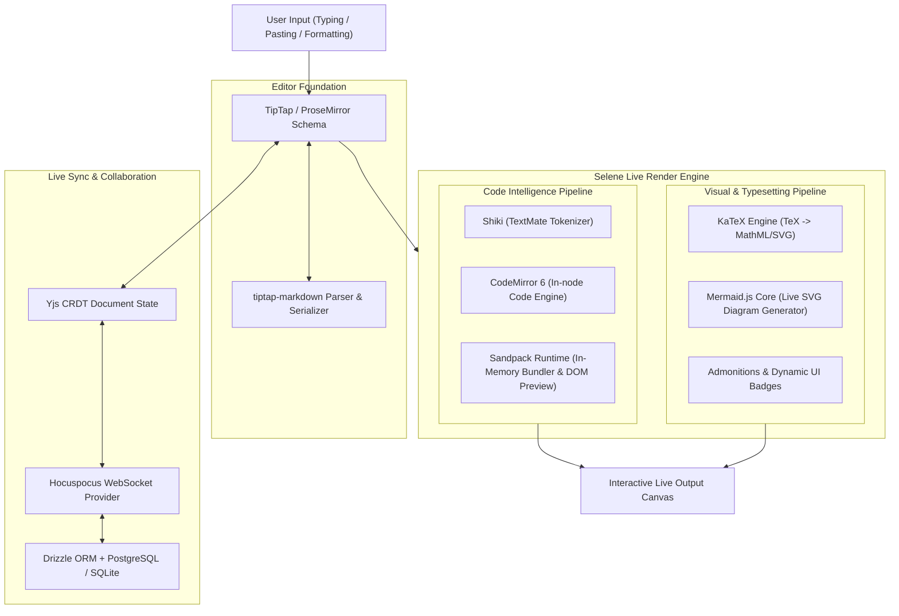

# 🌙 Selene

> **The Hypermodern Technical Document & Code Canvas**  
> *Where literate technical writing meets real-time code execution, interactive visual rendering, and seamless collaborative intelligence.* 🚀✨

[](https://nextjs.org/)
[](https://react.dev/)
[](https://tiptap.dev/)
[](https://codemirror.net/)
[](https://tailwindcss.com/)
[](https://www.typescriptlang.org/)
[]()

---

## 📖 Table of Contents

- [✨ Overview & Brief](#-overview--brief)
- [🎯 Purpose: Why Selene?](#-purpose-why-selene)
- [🔭 Scope & Core Capabilities](#-scope--core-capabilities)
- [⚡ The Live Render Engine Architecture](#-the-live-render-engine-architecture)
- [🛠️ Hypermodern Stack Matrix](#-hypermodern-stack-matrix)
- [🎨 Key User Experience Highlights](#-key-user-experience-highlights)
- [🗺️ Planned Implementations & Roadmap](#-planned-implementations--roadmap)
- [🚀 Build & Run Instructions](#-build--run-instructions)
- [📄 License & Credits](#-license--credits)

---

## ✨ Overview & Brief

**Selene** is an open-source, hypermodern **WYSIWYG technical canvas** engineered for developers, engineering managers, educators, and technical authors. 

Traditional markdown editors force a cognitive compromise: you either juggle raw ASCII tags with delayed side-by-side previews, or you use rigid rich-text tools (like Notion or Google Docs) that choke on complex code blocks, live diagrams, mathematical proofs, and executable snippets.

Selene dissolves this friction. Built on the unified foundations of **TipTap (ProseMirror)** for structured block orchestration and **CodeMirror 6** for code intelligence, Selene connects directly to a **top-of-the-line live execution & vector rendering engine**—allowing users to write prose, craft source code, render interactive UI components live in-memory, visualize diagrams, and collaborate in real time with zero latency. 🪄

---

## 💎 The Core Selling Point & Strategic Edge

> **Selene's defining advantage is its architectural ability to adapt to ANY web-based stack and deliver 100% faithful, zero-broken-CSS WYSIWYG renders with sub-millisecond live reload — laying the groundwork for interactive, no-code visual property controls.** 🎯✨

1. **🌐 Universal Web Stack Adaptability**: Whether writing standalone React TSX components, Vue 3 templates, Svelte widgets, modern Tailwind v4 layouts, or plain HTML/CSS, Selene dynamically provisions the correct runtime in-memory without demanding local toolchains or server round-trips.
2. **🔄 Seamless Live Reload (HMR)**: Code edits trigger instant, sub-millisecond hot reloads in isolated sandboxes while preserving runtime state and eliminating flicker.
3. **🛡️ 100% Faithful WYSIWYG Renders**: Eliminates the "broken preview" syndrome common to other editors. Dedicated sandbox boundaries and pre-injected stylesheet runtimes guarantee that your rendered components look and behave identically to production.
4. **🎛️ The Bridge to No-Code Visual Controls (Planned)**: The render engine's AST bridge will enable live visual property inspectors, slider controls, and color/spacing pickers directly on top of rendered components—unifying developers writing code and non-developers tweaking UI parameters in a single canvas.

---

## 🎯 Purpose: Why Selene?

1. **🧑‍💻 Code-First Prose Editing**: Writing documentation, technical RFCs, API designs, and architectural decision records (ADRs) shouldn't feel like typing in a 1990s text buffer. Code blocks in Selene aren't static grey rectangles; they are full-featured editor nodes with syntax tokens, line markers, language auto-detection, and live evaluation.
2. **⚡ Top-of-the-Line Live Rendering**: Render code outputs, live React/Vue/HTML previews, Mermaid diagrams, and LaTeX math *instantly* with zero server latency using browser-side sandbox runtimes (Sandpack / WebAssembly).
3. **🔄 True Bi-Directional Markdown Parity**: Never get locked into proprietary database formats. Switch at any millisecond between fluid Notion-style block editing and clean, portable, Git-friendly GitHub Flavored Markdown (GFM).
4. **👥 Real-Time Multiplayer Sync**: Seamless CRDT-based state reconciliation (Yjs) allowing teams to pair-write technical knowledge bases without overwrite conflicts.

---

## 🔭 Scope & Core Capabilities

- 📝 **Hybrid WYSIWYG & Raw Markdown**: Instant toggle between distraction-free visual block canvas and split-screen Markdown view.
- 💻 **Smart Code Block Nodes**:
  - Embedded **CodeMirror 6** / **Shiki** token engine.
  - Multi-theme switching (Tokyo Night, GitHub Dark, One Dark, Catppuccin) with VS Code TextMate parity.
  - Multi-language support (50+ languages) with fuzzy-search language picker.
  - Line numbers, diff/git highlight decorations, copy-to-clipboard, and code folding.
- 🏃‍♂️ **Live Interactive Sandboxes**:
  - In-browser live preview for HTML, CSS, JS, TypeScript, and modern frameworks (React, Vue, Svelte) via **Sandpack**.
  - Interactive Python snippet evaluation via **Pyodide** (WebAssembly).
- 📐 **Vector & Mathematical Typesetting**:
  - High-performance inline & display math formulas using **KaTeX** (`$E=mc^2$` and `$$\int f(x)dx$$`).
  - Native **Mermaid.js** live diagramming (flowcharts, sequence charts, ER diagrams, state machines, architecture graphs) with live SVG rendering and pan/zoom.
- ⚡ **Notion-Style Slash Commands (`/`) & Floating Bubble Toolbar**:
  - Rapid block insertion: Headings, Code Sandboxes, Admonitions/Callouts, Mermaid Charts, Formulas, Interactive Tables, Task Checklists.
  - Contextual floating bubble menu for formatting, inline code, and link embedding.
- 🌐 **Multiplayer Collaboration & Cloud Sync**:
  - Real-time peer editing powered by **Yjs** CRDTs with presence awareness (color-coded cursors and user avatars).
  - Robust auto-saving, local-first offline cache, and cloud sync via **Hocuspocus / WebSockets**.

---

## ⚡ The Live Render Engine Architecture

Selene decouples content authoring from rendering by routing node updates through a high-performance, multi-pipeline render engine:



### 🔬 The Polymorphic Live Render Engine (Context & Stack Aware)

Rather than forcing a single rigid renderer, Selene employs a **Polymorphic Render Pipeline** that automatically routes snippets to the ideal execution runtime based on project type and language target:

| Target Context | Dedicated Render Engine | Isolation & Capabilities |
| :--- | :--- | :--- |
| **🌐 Web Frameworks & UI Stacks**<br>*(React, Vue, Svelte, Next.js components, Tailwind)* | **Sandpack In-Memory Bundler** & **Isolated Shadow/Iframe Runner** | Full npm package resolution, complete CSS/Tailwind isolation, Hot Module Reloading (HMR) in-browser. |
| **📄 Documents, Math & Prose**<br>*(Markdown, LaTeX equations, GFM tables)* | **TipTap Core + KaTeX** | Sub-millisecond mathematical typesetting without layout shift, native DOM tables, markdown parity. |
| **📊 Architecture & Visuals**<br>*(Flowcharts, Sequence, ER Diagrams)* | **Mermaid.js Core Engine** | Live SVG compilation with automatic theme synchronization and pan/zoom interaction. |
| **🖥️ Systems, Desktop & Scripts**<br>*(Python, Rust/WASM, Go, Shell)* | **WebAssembly / Pyodide / WASI Runtime** | In-browser isolated execution sandbox for scripting and algorithm evaluation without server dependencies. |

---

## 🎯 The Core Proof-of-Concept (POC) Milestone

> **Our primary POC objective is our software's ability to seamlessly display complete, interactive live renders across diverse stacks without errors, style bleeding, or broken CSS.** 🛡️⚡

### How Selene Guarantees Zero Broken CSS & Error Resilience:
1. **🛡️ Total CSS & DOM Encapsulation**: Live component renders run inside dedicated sandboxed iframes and Shadow DOM boundaries. The host editor's UI styling and the user's project styling (such as Tailwind classes, custom CSS variables, or global resets) never collide or bleed into each other.
2. **🎨 First-Class Tailwind CSS Support in Previews**: The live runner pre-injects Tailwind compiler runtime into the sandbox context, guaranteeing that Tailwind utility classes, custom themes, and design tokens render with 100% visual fidelity.
3. **🧱 Resilient Error Boundaries & Render Freezing**: As you type code, syntax will inevitably be momentarily incomplete. Rather than crashing or showing a blank screen, Selene's engine freezes the last valid render and displays a subtle non-intrusive diagnostic badge until valid syntax is restored.
4. **🔄 Instant Hot-Swapping**: Switch between viewing the raw CodeMirror 6 code editor, the live interactive preview, or a side-by-side split canvas with a single keybinding or click.

---

## 🛠️ Hypermodern Stack Matrix

| Area | Technology | Role & Advantage |
| :--- | :--- | :--- |
| **Framework** | **Next.js 15+ (App Router)** | React 19, Server Components, Turbopack, edge-ready API routes |
| **Document Core** | **TipTap v2 (ProseMirror)** | Modular headless block engine, schema customization, extensibility |
| **Code Editor** | **CodeMirror 6** | Extensible, modular, lightweight, high-performance code editor |
| **Syntax Highlighting**| **Shiki** | VS Code TextMate grammars, multi-theme zero-flicker tokenization |
| **Web Live Sandbox** | **Sandpack (CodeSandbox)** | In-memory client-side bundler and live preview runner for UI code & frameworks |
| **WASM Runtime** | **Pyodide / WASI** | In-browser live execution for Python and systems code snippets |
| **Math Typesetting** | **KaTeX** | Ultra-fast inline and display mathematical notation rendering |
| **Live Diagrams** | **Mermaid.js** | Text-to-diagram SVG compilation with automatic dark/light theme sync |
| **Styling & Design** | **Tailwind CSS v4** + **Radix UI** | Lightning-fast zero-config CSS engine with accessible UI primitives |
| **Realtime CRDT** | **Yjs** + **Hocuspocus** | Conflict-free real-time sync, cursor awareness, and offline resilience |
| **Database & ORM** | **Drizzle ORM** + **PostgreSQL** | End-to-end type safety, instant migrations, SQLite local fallback |
| **Icons & Micro-animations** | **Lucide Icons** + **Framer Motion** | Polished, modern developer-centric micro-interactions |

---

## 🎨 Key User Experience Highlights

```
+-------------------------------------------------------------------------+
|  🌙 Selene  |  📂 My Workspace  /  Architecture.md           [Share] [Live] |
+-------------------------------------------------------------------------+
|                                                                         |
|  # Distributed Microservices Architecture 🚀                            |
|                                                                         |
|  This document specifies the event-driven communication model...        |
|                                                                         |
|  > [!TIP]                                                               |
|  > Ensure all payload events adhere to CloudEvents v1.0 specifications. |
|                                                                         |
|  ```mermaid                                                             |
|  sequenceDiagram                                                        |
|      Client->>Gateway: POST /v1/orders                                  |
|      Gateway->>Kafka: Publish OrderCreated                              |
|      Kafka-->>Inventory: Consume Event                                  |
|  ```                                                                    |
|  [ Live SVG Diagram Rendered Seamlessly Inline with Pan & Zoom ]        |
|                                                                         |
|  ```tsx (Live Sandbox Preview)                                [Run] [Copy]
|  export function OrderWidget() {                                        |
|    return <button className="bg-sky-500 text-white p-2">Submit</button>|
|  }                                                                      |
|  ```                                                                    |
|  +-------------------------------------------------------------------+  |
|  | [Live Sandpack Preview Area: Interactive Rendered Button]         |  |
|  +-------------------------------------------------------------------+  |
|                                                                         |
+-------------------------------------------------------------------------+
```

---

## 🗺️ Implementations & Roadmap Status

### 🏁 Phase 1: Foundation & App Shell
- [x] Initialize Next.js 16, React 19, TypeScript, and Tailwind CSS v4 workspace.
- [x] Establish application shell with collapsible workspace sidebar and top header.
- [x] Configure dark theme design system with responsive layouts.

### ✍️ Phase 2: Core TipTap & Markdown Canvas
- [x] Configure TipTap v3 with `tiptap-markdown` for two-way GFM parsing and export.
- [x] Build floating bubble formatting menu (bold, italic, strikethrough, inline code, headings, math).
- [x] Build Notion-style Slash (`/`) command palette with real-time fuzzy search and keyboard traversal.
- [x] Implement Task Lists, Admonitions/Callouts (`[!NOTE]`, `[!TIP]`, `[!WARNING]`).

### ⚡ Phase 3: Live Render Engine & Code Intelligence
- [x] Build Custom Code Block NodeView routing to specialized polymorphic renderers.
- [x] Integrate **Sandpack** for client-side multi-stack live execution (React, Vue 3, Svelte, HTML/CSS).
- [x] Pre-injected isolated Tailwind runtime guaranteeing 100% visual fidelity with zero broken CSS.
- [x] Implement **No-Code Visual Property Inspector** (live tweaking of colors, radius, padding, shadows).
- [x] Implement **KaTeX** inline and display mathematical typesetting.
- [x] Implement **Mermaid.js** diagramming NodeView with interactive SVG preview and error boundary.

### 💾 Phase 4: Persistence, Workspace & Storage
- [x] Setup Drizzle ORM schema with LibSQL / SQLite local database (`/data/selene.db`).
- [x] Implement Next.js REST API route handlers (`/api/documents` and `/api/documents/[id]`).
- [x] Multi-document workspace management with local storage and database auto-sync.
- [x] Implement automatic Revision History snapshots with 1-click version restore.
- [x] Markdown file import (`.md`, `.txt`) and export.

### 👥 Phase 5: Real-time Collaboration & Multiplayer
- [x] Integrate **Yjs** CRDT document state with **WebRTC** peer-to-peer live synchronization.
- [x] Multi-user presence awareness (peer count indicator, colored user avatars).
- [x] Zen / Presentation mode for distraction-free technical writing and reading.

---

## 🚀 Build & Run Instructions

Selene includes automated, multi-platform scripts for running the development server and compiling production distribution bundles with dependency verification and quality suites.

### 📋 Prerequisites
- **Node.js**: `v18.0.0` or higher (tested with `v24.x`)
- **Package Manager**: `npm` (v10+)
- **Operating Systems**: Windows (PowerShell), Linux, macOS, or Cygwin

---

### 🏃 Running the Development Server

The run script checks Node.js, npm, dependency presence (auto-installing if missing), verifies port availability, and launches the Next.js Turbopack development server with verbose logging:

#### On Windows (PowerShell):
```powershell
# Default port 3000
.\tools\scripts\run\run.ps1

# Custom port or host
.\tools\scripts\run\run.ps1 -Port 8080 -HostName "0.0.0.0"
```

#### On Linux, macOS, or Cygwin:
```bash
# Ensure execution permissions (first run)
chmod +x tools/scripts/run/run.sh

# Run development server
./tools/scripts/run/run.sh

# Run on custom port/host
./tools/scripts/run/run.sh 8080 0.0.0.0
```

Open [http://localhost:3000](http://localhost:3000) in your browser.

---

### 🔨 Compiling for Production & Running Tests

The build script performs environment validation, executes the full quality sanity test suite (TypeScript type check and ESLint), and compiles the production distribution bundle:

#### On Windows (PowerShell):
```powershell
# Run full sanity suite and compile production build
.\tools\scripts\build\build.ps1

# Clean previous build artifacts (.next) before building
.\tools\scripts\build\build.ps1 -Clean

# Skip test suite (fast build)
.\tools\scripts\build\build.ps1 -SkipTests
```

#### On Linux, macOS, or Cygwin:
```bash
# Ensure execution permissions (first run)
chmod +x tools/scripts/build/build.sh

# Run full sanity suite and compile production build
./tools/scripts/build/build.sh

# Clean previous build artifacts
./tools/scripts/build/build.sh "" --clean

# Skip test suite
./tools/scripts/build/build.sh --skip-tests
```

### 🧪 Standalone NPM Quality Commands
```bash
# Run TypeScript compilation check
npm run type-check

# Run ESLint static analysis
npm run lint

# Run combined test suite
npm test
```

---

## 📄 License & Credits

- Licensed under the **MIT License**.
- Inspired by the best of **Notion**, **VS Code**, **CodeSandbox**, and **Obsidian**.
- Built with ❤️ using [TipTap](https://tiptap.dev/), [ProseMirror](https://prosemirror.net/), [CodeMirror 6](https://codemirror.net/), [Shiki](https://shiki.style/), and [Next.js](https://nextjs.org/).
