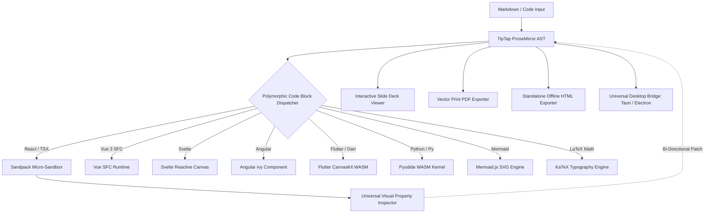

# 🌙 Selene

> **The Hypermodern Technical Document & Code Canvas**  
> *Where literate technical writing meets real-time code execution, interactive visual rendering, and seamless collaborative intelligence.* 🚀✨

[-sky?style=for-the-badge&logo=rocket)](https://github.com/indoctrinatedrecluse/Selene/releases)
[-black?style=for-the-badge&logo=next.js)](https://nextjs.org/)
[](https://react.dev/)
[-24C8D8?style=for-the-badge&logo=tauri)](https://tauri.app/)
[](https://pyodide.org/)
[](https://tailwindcss.com/)
[](LICENSE)

---

## 📖 Table of Contents

- [✨ Overview & Product Brief](#-overview--product-brief)
- [🏛️ Mythological Origins: Selene, Titaness of the Moon](#-mythological-origins-selene-titaness-of-the-moon)
- [💎 Strategic Pillars Delivered (Titan Edition)](#-strategic-pillars-delivered-titan-edition)
  - [1. 🎛️ Universal No-Code "Visual Tweak Props & Inspector" (Bi-Directional AST Sync)](#1-️-universal-no-code-visual-tweak-props--inspector-bi-directional-ast-sync)
  - [2. 📄 Universal Document Publishing & Export Suite](#2--universal-document-publishing--export-suite)
  - [3. 🐍 In-Browser Data Science & Computational Notebooks (Pyodide WASM)](#3--in-browser-data-science--computational-notebooks-pyodide-wasm)
  - [4. 🖥️ Native Desktop Packaging (Tauri v2 & Electron Offline Shell)](#4-️-native-desktop-packaging-tauri-v2--electron-offline-shell)
- [📂 Product Showcase & Samples Gallery (`samples/`)](#-product-showcase--samples-gallery-samples)
- [⚡ The Live Render Engine Architecture](#-the-live-render-engine-architecture)
- [🛠️ Hypermodern Stack Matrix](#-hypermodern-stack-matrix)
- [🚀 Build, Run & Desktop Instructions](#-build-run--desktop-instructions)
- [📦 Release Workflow & Tag Publishing](#-release-workflow--tag-publishing)
- [📄 License & Credits](#-license--credits)

---

## ✨ Overview & Product Brief

**Selene** is an open-source, hypermodern **WYSIWYG technical canvas** engineered for developers, engineering managers, educators, data scientists, and technical authors. 

Traditional markdown editors force a cognitive compromise: you either juggle raw ASCII tags with delayed side-by-side previews, or you use rigid rich-text tools (like Notion or Google Docs) that choke on complex code blocks, live diagrams, mathematical proofs, and executable snippets.

Selene dissolves this friction. Built on the unified foundations of **TipTap (ProseMirror)** for structured block orchestration, **CodeMirror 6** for code intelligence, and **Pyodide WebAssembly** for computational kernels, Selene connects directly to a **top-of-the-line live execution & vector rendering engine**—allowing users to write prose, craft source code, render interactive UI components live in-memory, evaluate Python data science models, visualize diagrams, and collaborate in real time with zero latency. 🪄

---

## 🏛️ Mythological Origins: Selene, Titaness of the Moon

> *“And from her immortal head a radiance is shown from heaven, and deep night is wrapped about her splendor...”*  
> — **Homeric Hymn XXXII to Selene**

Selene is named in reverence to **Selene (Σελήνη)**, the primordial Greek Titaness of the Moon. Daughter of the Titans Hyperion and Theia, sister to Helios (the Sun) and Eos (the Dawn), Selene mounts her radiant silver chariot drawn by celestial winged steeds each twilight, sweeping across the night sky to illuminate the earth with gentle, calming clarity.

### The Engineering Allegory:
- 🌌 **The Nocturnal Firmament & The Lunar Torch**: Navigating dense codebases, convoluted ASTs, and fragmented technical prose is like traveling through midnight darkness. Just as Selene's lunar light brings infallible clarity without the scorching glare of the sun, our platform illuminates your code, markdown prose, math, and diagrams with effortless, accurate live rendering.
- 🛡️ **Pristine Celestial Isolation (Zero CSS Bleed)**: The lunar sphere exists in peaceful vacuum isolation. Selene enforces pristine isolation boundaries around code execution so user stylesheets and framework resets never corrupt the host document canvas.
- 🌙 **The Patron of Late-Night Craftsmanship**: Selene is the guardian of the quiet midnight hours when programmers, architects, and technical authors do their most profound, uninterrupted deep work.

---

## 💎 Strategic Pillars Delivered (Titan Edition)

### 1. 🎛️ Universal No-Code "Visual Tweak Props & Inspector" (Bi-Directional AST Sync)
- **Bi-Directional AST Transformation Engine** (`src/lib/ast-transformer.ts`): Live parsing and token extraction across **React (TSX/JSX)**, **Vue 3 SFC**, **Svelte 4/5**, **Angular Ivy**, and **Vanilla HTML/Tailwind**.
- **4-Tab Visual Property Inspector**: Visual no-code controls for Theme & Surface (gradients, colors, shadows), Layout & Geometry (padding, radiuses), Content & Typography (text, font weights), and State & Logic (reactive counter updates).
- **Zero Loss Code Sync**: Edits made in the visual inspector patch the underlying source code and TipTap ProseMirror document AST seamlessly.

### 2. 📄 Universal Document Publishing & Export Suite
- **Vector Print PDF Engine** (`src/lib/pdf-export.ts`): Print-optimized vector PDF exporter with KaTeX formulas, high-DPI Mermaid SVGs, and automated page-break avoidance.
- **Standalone Offline Single-File HTML** (`src/lib/html-export.ts`): Bundles Tailwind CSS runtime, KaTeX stylesheets, and Mermaid.js into a single `.html` file that runs anywhere without a web server.
- **Interactive Presentation Slide Deck Mode** (`src/components/presentation/SlideDeckViewer.tsx`): Turns any markdown document into a full-screen presentation with presenter timer, slide progress bar, thumbnail drawer, and live interactive running widgets directly on slides (`F5` or **Deck Mode**).

### 3. 🐍 In-Browser Data Science & Computational Notebooks (Pyodide WASM)
- **Pyodide WebAssembly Python 3.12 Kernel** (`src/lib/pyodide-engine.ts`): 100% client-side Python execution without backend servers, Docker, or containers.
- **Automatic Scientific Package Ingestion**: Auto-loads **NumPy**, **Pandas**, **Matplotlib**, and **SciPy** on-demand from code import statements.
- **Publication-Grade Matplotlib Extraction**: Headless `Agg` graphics pipeline automatically renders dark celestial styling (`#090d16`, `#0f172a`, `#38bdf8`) and extracts high-DPI (140 DPI) plots as base64 PNGs.
- **Interactive Computational Cell** (`PythonNotebookRenderer.tsx`): Multi-line code editor with execution timer, `Ctrl+Enter` shortcut, and curated presets (Lunar Orbit Trajectory, Monte Carlo Pi, Rover Telemetry).

### 4. 🖥️ Native Desktop Packaging (Tauri v2 & Electron Offline Shell)
- **Tauri v2 Native Rust Shell** (`src-tauri/`): Ultra-lightweight native desktop binary (<50MB RAM) with native OS WebView2/WebKit integration.
- **Electron Companion Desktop Shell** (`electron/`): Zero-compile instant desktop shell with native menu bars (File, Edit, View, Help) and local dev server discovery.
- **Universal Desktop Bridge** (`src/lib/desktop-bridge.ts`): Unified file I/O abstraction across Tauri v2, Electron, and modern Web File System Access API (`showOpenFilePicker` / `showSaveFilePicker`). Native File Open (`Ctrl+O`) and Save (`Ctrl+S`) direct to local disk.
- **Desktop Header Controls**: Dedicated Open and Save Disk buttons with desktop runtime indicator badge.

---

## 📂 Product Showcase & Samples Gallery (`samples/`)

Selene includes curated, production-ready sample documents in the [`samples/`](./samples) directory:

| Sample Document | Tech Stack & Capabilities | File Link |
|---|---|---|
| **01. Selene Architecture & Live Canvas** | React + Tailwind Sandbox, Tweak Props Inspector, Mermaid Sequence Diagram, LaTeX Math | [`01_selene_architecture_and_live_canvas.md`](./samples/01_selene_architecture_and_live_canvas.md) |
| **02. Interactive Web UI Components** | React Metric Card, Vue 3 Composition SFC, Svelte 5 Reactive Sandbox | [`02_interactive_web_ui_components.md`](./samples/02_interactive_web_ui_components.md) |
| **03. Angular & Flutter Showcase** | Angular Ivy with Scoped CSS, Flutter Web Material 3 CanvasKit WASM | [`03_angular_and_flutter_showcase.md`](./samples/03_angular_and_flutter_showcase.md) |
| **04. Python WASM Data Science Notebook** | Pyodide WASM, NumPy Orbit Simulation, Matplotlib Plot, Pandas DataFrame | [`04_python_wasm_datascience_notebook.md`](./samples/04_python_wasm_datascience_notebook.md) |
| **05. Presentation Slide Deck Demo** | Multi-slide presentation, live running widgets on slides, presenter timer | [`05_presentation_slide_deck_demo.md`](./samples/05_presentation_slide_deck_demo.md) |

Open any sample in Selene with **Open File** (`Ctrl+O`) or via the **Help -> About** gallery shortcut!

---

## ⚡ The Live Render Engine Architecture



---

## 🛠️ Hypermodern Stack Matrix

| Layer | Technology | Role & Purpose |
|---|---|---|
| **Core Framework** | **Next.js 16 + React 19** | Turbopack compilation, partial prerendering, and API routes. |
| **Document State** | **TipTap (ProseMirror)** | Headless block editing, schema AST, and custom NodeViews. |
| **Code Editor** | **CodeMirror 6 + Shiki** | Syntax intelligence, TextMate themes, and tokenization. |
| **Live Sandboxes** | **Sandpack React** | Zero-leak in-memory micro-sandboxes for React, Vue, Svelte, HTML. |
| **WASM Python** | **Pyodide v0.26** | In-browser Python 3.12, NumPy, Pandas, and Matplotlib. |
| **Mobile Canvas** | **Flutter CanvasKit** | Material 3 & Cupertino widgets running via WebAssembly. |
| **Vector & Math** | **Mermaid.js + KaTeX** | Dynamic SVG architecture diagrams and LaTeX equations. |
| **Desktop Shell** | **Tauri v2 + Electron** | Native cross-platform desktop shells for Windows, macOS, Linux. |
| **Styling** | **Tailwind CSS v4** | Dark midnight theme with celestial lunar mythos accents. |
| **Collaboration** | **Yjs + WebRTC** | Real-time multiplayer CRDT peer synchronization. |
| **Persistence** | **Drizzle ORM + LibSQL** | Local SQLite storage with automatic localStorage fallback. |

---

## 🚀 Build, Run & Desktop Instructions

Selene includes automated multi-platform scripts for both web and native desktop workflows:

### 1. Development Web Server
```powershell
# Windows (PowerShell)
.\tools\scripts\run\run.ps1

# Linux / macOS / Cygwin
./tools/scripts/run/run.sh
```
Open [http://localhost:3000](http://localhost:3000) in your browser.

### 2. Native Desktop Application
```powershell
# Run desktop shell with Electron (instant launch)
.\tools\scripts\desktop\run-desktop.ps1

# Run desktop shell with Tauri v2 (Rust WebView2)
.\tools\scripts\desktop\run-desktop.ps1 -Engine tauri

# Using npm scripts directly
npm run desktop:dev     # Electron shell
npm run desktop:tauri   # Tauri v2 shell
```

### 3. Production Build & Quality Sanity Suite
```powershell
# Windows (PowerShell)
.\tools\scripts\build\build.ps1

# Linux / macOS / Cygwin
./tools/scripts/build/build.sh
```

### 4. Package Native Desktop Binaries
```powershell
# Windows (PowerShell)
.\tools\scripts\desktop\package-desktop.ps1 -Target tauri

# Linux / macOS
./tools/scripts/desktop/package-desktop.sh tauri
```

---

## 📦 Release Workflow & Tag Publishing

Selene uses an automated GitHub Actions release suite (`.github/workflows/release.yml`).

To trigger an automated cross-platform release build and publish distribution binaries:
```bash
# 1. Ensure all changes are committed
git status

# 2. Create a semantic version tag (e.g., v0.1.0)
git tag -a v0.1.0 -m "Release v0.1.0 — Titan Edition"

# 3. Push tag to GitHub
git push origin v0.1.0
```

GitHub Actions will automatically:
1. Run quality & sanity verification (`type-check` and `eslint`).
2. Compile production Next.js assets.
3. Build native desktop binaries:
   - **Windows**: `.msi` installer & `.exe` portable binary
   - **macOS**: Universal `.dmg` disk image (Apple Silicon + Intel)
   - **Linux**: `.AppImage` & `.deb` package
4. Publish an official GitHub Release with downloadable binary artifacts.

---

## 🔐 Licensing, Tamper-Proof 60-Day Trial & Device Authority

Selene features an industry-grade cryptographic licensing subsystem backed by **[Licensor](https://licensor-h5zdysrkqa-uc.a.run.app)** and local **Windows Registry (`HKCU\Software\Selene`)** persistence across uninstalls and updates:

- **60-Day Evaluation Trial**: Automatic out-of-the-box trial with HMAC-SHA256 signature verification, anti-clock rollback detection, and secondary anchor synchronization. If the trial expires or tampering is detected, the application gracefully enters time-lock mode until a paid license is bound.
- **Tiered Badges (Ascending Prestige)**:
  - 🛡️ **User Edition (`USER-xxxx-xxxx-xxxx`)**: Standard seat-licensed end-user edition with username/password validation.
  - 💻 **Developer Edition (`DEV-xxxx-xxxx-xxxx`)**: Elevated developer edition featuring neon badge styling and engine inspection tools.
  - 👑 **Titan Administrator (`ADM-xxxx-xxxx-xxxx`)**: Celestial gold badge status with master privileges, automatic HWID node-locking, and zero password prompt requirements.
- **Device Node-Locking (HWID)**: Machine hardware fingerprints (MachineGuid + CPU architecture + host parameters) bind licenses securely to designated seats.
- **Hardware-Bound AES-256-GCM Secure Vault**: License keys and future AI credentials (**Google Gemini**, **OpenAI**, **Anthropic Claude**) are encrypted with authenticated AES-256-GCM using keys derived via PBKDF2 (100,000 rounds SHA-512) keyed to the machine's hardware fingerprint and Windows user account. Persists permanently in `HKCU\Software\Selene\Vault`.
- **License & Vault Manager**: Accessible directly from the top header or **Help -> Manage License & Device...** to manage keys, toggle digit masking, view seat duration, configure AI keys, or revert to trial.
- **Client App Attestation & API Gatekeeper** (`src/middleware.ts`):
  - Every API request from the client app carries a cryptographic HMAC-SHA256 signature (`X-Selene-Signature`), application attestation ID (`X-Selene-App-ID`), anti-replay timestamp (`X-Selene-Timestamp`), HWID (`X-Selene-HWID`), and a cryptographically signed license attestation token (`X-Selene-License-Token`).
  - Next.js server middleware strictly validates all incoming calls: raw cURL scripts, Postman probes, external websites, and requests without a valid active license or trial are rejected immediately with `401 Unauthorized` or `403 Forbidden`.

---

## ☁️ Google Cloud Run Backend Deployment

Selene's backend is containerized for seamless, serverless deployment to **Google Cloud Run**:

- **Multi-Stage Container** (`Dockerfile`): Next.js 16 standalone compilation with non-root security user (`nextjs:nodejs`), sub-100MB image footprint, and zero cold-start delay.
- **Automated Deployment Scripts**:
  - Windows: `.\tools\scripts\cloud\deploy-cloudrun.ps1` (or `npm run deploy:cloudrun`)
  - Linux/macOS: `./tools/scripts/cloud/deploy-cloudrun.sh`
- **Database Flexibility**: Supports remote LibSQL / Turso databases via `DATABASE_URL` or serverless container-safe `/tmp` persistence.

---

## 📄 License & Copyright

- **Proprietary Source-Available License**. Copyright © 2026 **Abhishek Mitra (indoctrinatedrecluse)**. All rights reserved.
- Any modification, transformation, redistribution, republication, or commercial deployment strictly requires explicit prior written approval.
- For licensing inquiries, permissions, or custom enterprise seat pools:
  - **Author**: Abhishek Mitra
  - **Email**: [abmitra1999@gmail.com](mailto:abmitra1999@gmail.com)
  - **Portfolio & Contact Form**: [https://portfolio-flutter-78bcf.web.app/](https://portfolio-flutter-78bcf.web.app/)
- Dedicated to **Selene (Σελήνη)**, Titaness of the Moon.
- Built with ❤️ using [TipTap](https://tiptap.dev/), [ProseMirror](https://prosemirror.net/), [Pyodide](https://pyodide.org/), [Tauri](https://tauri.app/), [Sandpack](https://sandpack.codesandbox.io/), and [Next.js](https://nextjs.org/).
