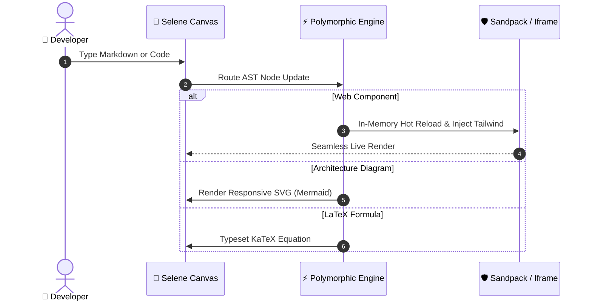

# 🌙 Selene Technical Specification & Live Canvas

Welcome to **Selene** — the hypermodern technical document & code canvas where markdown prose seamlessly integrates with live code execution and vector graphics! ✨

> [!NOTE]
> 🏛️ **Named for Selene, Titaness of the Moon (Σελήνη)**:
> In Greek mythology, Selene drives her radiant silver chariot across the nocturnal cosmos, illuminating the earth with gentle, serene clarity. Selene is engineered with that same philosophy: illuminating complex codebases, AST nodes, and technical documentation with effortless live rendering, isolated sandboxes, and zero CSS leakage. Click **Titan Lore** in the top navigation bar to explore the heritage.

---

## ⚡ 1. Live React & Tailwind Sandbox

Below is an interactive live React component. Click **Tweak Props** in the header above the sandbox to adjust theme colors, corner radiuses, and padding visually with no-code controls!

```tsx
import React, { useState } from "react";

export default function LiveInteractiveCard() {
  const [likes, setLikes] = useState(42);

  return (
    <div className="p-6 max-w-sm mx-auto bg-slate-900 rounded-2xl border border-slate-700/60 shadow-xl space-y-4">
      <div className="flex items-center gap-3">
        <div className="w-10 h-10 rounded-full bg-gradient-to-tr from-sky-400 to-indigo-500 flex items-center justify-center font-bold text-white shadow-md">
          S
        </div>
        <div>
          <h3 className="text-base font-semibold text-white">Selene Live Preview</h3>
          <p className="text-xs text-sky-400">Isolated HMR Sandbox</p>
        </div>
      </div>
      <p className="text-sm text-slate-300">
        Edit this code directly or use the Tweak Props panel to adjust visual styling without writing code!
      </p>
      <div className="pt-2 flex items-center justify-between border-t border-slate-800">
        <button
          onClick={() => setLikes(l => l + 1)}
          className="px-3.5 py-1.5 rounded-lg bg-sky-500 hover:bg-sky-400 text-white text-xs font-semibold transition-all shadow-md active:scale-95 cursor-pointer"
        >
          ❤️ Like ({likes})
        </button>
        <span className="text-xs font-mono text-slate-400">Tailwind CSS Active</span>
      </div>
    </div>
  );
}
```

---

## 📊 2. Live Mermaid.js System Diagram

Text-based diagrams compile into responsive SVG graphics dynamically:



---

## 📐 3. Mathematical Typesetting

Equations typeset in sub-millisecond speeds:

```math
\mathcal{L}_{\text{total}} = \lambda_1 \mathcal{L}_{\text{fidelity}} + \lambda_2 \sum_{i=1}^N \| \hat{y}_i - y_i \|^2 + \mathbb{E}_{x \sim p_{\text{data}}}[\log D(x)]
```
