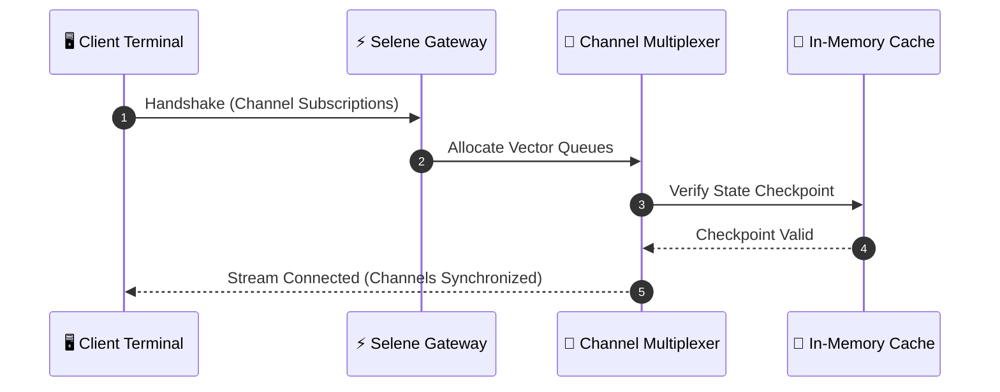

# 🎨 Dual Document Canvas & Freeform Whiteboard Showcase

Selene combines technical literate computing with spatial document comparison and freeform sketching overlays. Read documentation side-by-side with your code while capturing architectural diagrams on an infinite whiteboard canvas.

> [!NOTE]
> 🪟 **Dual Split Architecture**:
> - **Side-by-Side Reference**: Open two documents simultaneously in vertical or horizontal split view (`Dual Split` button in the top navbar).
> - **Synchronized Scroll Locking**: Enable `Sync Scroll` to keep parallel sections or translated documents aligned in real-time.
> - **Zero-Overhead Whiteboard**: Toggle the pen overlay (`Whiteboard` icon or `Ctrl+Shift+W`) to sketch system diagrams directly over your live document, then export as PNG or SVG.

---

## ⚡ 1. Primary Implementation Document

Below is the primary implementation code block running in the active editor pane:

```tsx
import React, { useState } from "react";

export default function DualPaneTelemetryWidget() {
  const [activeChannel, setActiveChannel] = useState("alpha");
  const [channels] = useState([
    { id: "alpha", name: "Alpha Telemetry", frequency: "2.4 GHz", status: "locked" },
    { id: "beta", name: "Beta Uplink", frequency: "5.8 GHz", status: "carrier_ok" },
    { id: "gamma", name: "Gamma Deep-Space", frequency: "8.4 GHz", status: "syncing" },
  ]);

  return (
    <div className="p-6 max-w-md mx-auto bg-slate-900 rounded-2xl border border-sky-500/30 text-white shadow-2xl space-y-4">
      <div className="flex items-center justify-between border-b border-slate-800 pb-3">
        <h3 className="font-bold text-sky-400">Selene Channel Multiplexer</h3>
        <span className="text-xs font-mono px-2 py-0.5 rounded-full bg-emerald-500/10 text-emerald-400 border border-emerald-500/20">
          ONLINE
        </span>
      </div>

      <div className="space-y-2">
        {channels.map((ch) => (
          <div
            key={ch.id}
            onClick={() => setActiveChannel(ch.id)}
            className={`p-3 rounded-xl border text-xs cursor-pointer transition-all flex items-center justify-between ${
              activeChannel === ch.id
                ? "bg-sky-500/20 border-sky-500/50 text-white font-semibold"
                : "bg-slate-950/60 border-slate-800 text-slate-300 hover:border-slate-700"
            }`}
          >
            <div>
              <p className="font-medium">{ch.name}</p>
              <p className="text-[10px] text-slate-400 font-mono">{ch.frequency}</p>
            </div>
            <span className="text-[10px] font-mono text-cyan-300 uppercase">{ch.status}</span>
          </div>
        ))}
      </div>
    </div>
  );
}
```

---

## 🏛️ 2. Architectural Protocol Sequence

Reference the messaging sequence below while inspecting client socket states:



---

## 📐 3. Synchronized Mathematical Calibration

Calibrate link margin and carrier-to-noise spectral density ratio:

```math
\frac{C}{N_0} = \text{EIRP} - L_{\text{free}} + \frac{G}{T} - k_{\text{Boltzmann}}
```
