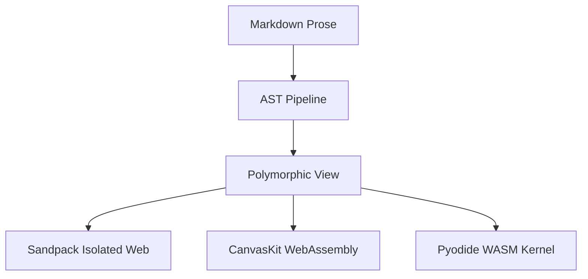

# 🌙 Selene Deck: The Future of Technical Canvas
A hypermodern presentation powered by markdown and live WebAssembly widgets

Press **Deck Mode** in the header or hit `F5` to present!

---

# Architecture Overview
Micro-sandboxes, isolated execution, and zero CSS leakage

Selene's core rendering engine provides strict encapsulation so user code and styles never corrupt host typography:



---

# Live React & Tailwind Sandbox
Interactive components run natively on your presentation slides

```tsx
export function PresentationWidget() {
  const [votes, setVotes] = React.useState(12);
  return (
    <div className="p-6 bg-slate-900 rounded-2xl border border-sky-500/40 text-white max-w-md mx-auto space-y-3">
      <h3 className="text-base font-bold text-sky-400">Live Running Component on Slide</h3>
      <p className="text-xs text-slate-300">Clicking this button increments reactive state right during your presentation:</p>
      <button
        onClick={() => setVotes(v => v + 1)}
        className="px-4 py-2 bg-sky-500 hover:bg-sky-400 rounded-xl text-xs font-bold transition-all shadow-lg cursor-pointer"
      >
        🌟 Audience Votes: {votes}
      </button>
    </div>
  );
}
```

---

# Mathematical Rigor
Typesetting complex formulations in sub-millisecond KaTeX:

```math
\oint_{\partial \Sigma} \mathbf{E} \cdot d\boldsymbol{\ell} = -\frac{d}{dt} \iint_{\Sigma} \mathbf{B} \cdot d\mathbf{S}
```

---

# Thank You!
Empowering engineers, authors, and teams to build illuminated documentation

- 🌟 GitHub: https://github.com/indoctrinatedrecluse/Selene
- 📜 Proprietary Source-Available License (© Abhishek Mitra)
- 🌙 Named in honor of Selene, Titaness of the Moon
